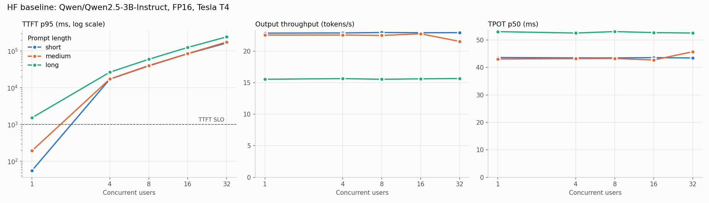

# Week 2 baseline report: hf-fp16-t4

Generated 2026-10-19 01:45 UTC

## Environment
| | |
|---|---|
| GPU | Tesla T4 (1 of 2 used) |
| Model | Qwen/Qwen2.5-3B-Instruct (3.09B params), FP16 |
| Engine | InferOps HF baseline (serial, max_concurrency=1) |
| torch / transformers | 2.11.0+cu128 / 5.16.1 |
| Python | 3.13.15 |

## Workload
Closed-loop load, 32 requests per level, 128 output tokens (ignore_eos),
temperature 0. SLO: TTFT <= 1000 ms and TPOT <= 100 ms.

## Results
| dataset | concurrency | rps | out_tok_s | ttft_p50_ms | ttft_p95_ms | ttft_p99_ms | tpot_p50_ms | tpot_p95_ms | goodput_rps | slo_pct | peak_mem_gb | errors |
|---|---|---|---|---|---|---|---|---|---|---|---|---|
| short | 1 | 0.179 | 22.9 | 52.7 | 56.0 | 60.4 | 43.6 | 44.8 | 0.179 | 100.0 | 6.2 | 0 |
| short | 4 | 0.179 | 22.9 | 16775.2 | 17089.7 | 17151.2 | 43.5 | 44.7 | 0.006 | 3.1 | 6.2 | 0 |
| short | 8 | 0.179 | 23.0 | 39074.3 | 39190.8 | 39214.5 | 43.5 | 44.2 | 0.006 | 3.1 | 6.2 | 0 |
| short | 16 | 0.179 | 22.9 | 83639.7 | 83983.7 | 84047.5 | 43.6 | 44.2 | 0.006 | 3.1 | 6.2 | 0 |
| short | 32 | 0.179 | 22.9 | 87362.7 | 164673.4 | 171447.3 | 43.5 | 44.8 | 0.006 | 3.1 | 6.2 | 0 |
| medium | 1 | 0.176 | 22.6 | 188.2 | 193.7 | 195.4 | 43.1 | 43.8 | 0.176 | 100.0 | 6.6 | 0 |
| medium | 4 | 0.176 | 22.6 | 17223.2 | 17351.0 | 17399.5 | 43.2 | 43.7 | 0.006 | 3.1 | 6.6 | 0 |
| medium | 8 | 0.176 | 22.5 | 39855.5 | 40189.3 | 40467.2 | 43.3 | 44.7 | 0.005 | 3.1 | 6.6 | 0 |
| medium | 16 | 0.178 | 22.8 | 84062.2 | 84966.8 | 85026.4 | 42.8 | 43.4 | 0.006 | 3.1 | 6.6 | 0 |
| medium | 32 | 0.168 | 21.5 | 90902.5 | 175358.0 | 182703.2 | 45.8 | 48.1 | 0.005 | 3.1 | 6.6 | 0 |
| long | 1 | 0.121 | 15.5 | 1502.6 | 1528.9 | 1542.7 | 53.1 | 53.4 | 0.000 | 0.0 | 8.5 | 0 |
| long | 4 | 0.122 | 15.6 | 25961.6 | 26515.7 | 26547.8 | 52.6 | 53.6 | 0.000 | 0.0 | 8.5 | 0 |
| long | 8 | 0.121 | 15.5 | 58972.7 | 59527.1 | 59557.3 | 53.1 | 53.7 | 0.000 | 0.0 | 8.5 | 0 |
| long | 16 | 0.122 | 15.6 | 124030.4 | 124794.1 | 124950.6 | 52.7 | 53.2 | 0.000 | 0.0 | 8.5 | 0 |
| long | 32 | 0.122 | 15.7 | 127923.9 | 241925.8 | 252130.1 | 52.6 | 53.0 | 0.000 | 0.0 | 8.5 | 0 |

## Bandwidth analysis
- Bandwidth ceiling at batch size 1: 51.8 tokens/s
- Achieved: 22.9 tokens/s, so MBU = 44%

## Findings
_Write these yourself. See the questions at the end of the notebook._
