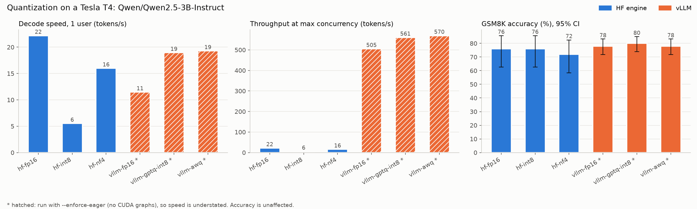

# Week 3 report: quantization on a Tesla T4

Generated 2026-10-19 04:10 UTC

## Environment
| | |
|---|---|
| GPU | Tesla T4 |
| Model | Qwen/Qwen2.5-3B-Instruct and Qwen's official AWQ / GPTQ-Int8 checkpoints |
| torch / transformers (HF track) | 2.11.0+cu128 / 5.16.1 |
| vLLM | 0.32.0, args: --dtype half --max-model-len 4096 --gpu-memory-utilization 0.90 --enforce-eager  |

## Workload
- Speed: `medium` prompts, 128 output tokens (ignore_eos), temperature 0.
  HF concurrency 1 x 16 requests; vLLM concurrency 1,8,32 x 64 requests.
- Quality: first N GSM8K test questions, greedy decoding, up to 512 tokens.
  N = 50 (HF) / 200 (vLLM).

## Results
| config | engine | precision | weights_gb | kv_cache_tokens | tpot_c1_ms | tok_s_c1 | max_conc | tok_s_max | ttft_p95_max_ms | gsm8k_acc | ci_lo | ci_hi | n | truncated |
|---|---|---|---|---|---|---|---|---|---|---|---|---|---|---|
| hf-fp16 | hf | fp16 | 6.1 |  | 44.3 | 22.2 | 1 | 22.2 | 166.4 | 76.0 | 62.6 | 85.7 | 50 | 0 |
| hf-int8 | hf | int8 | 3.4 |  | 180.6 | 5.5 | 1 | 5.5 | 325.7 | 76.0 | 62.6 | 85.7 | 50 | 1 |
| hf-nf4 | hf | nf4 | 2.2 |  | 61.2 | 16.0 | 1 | 16.0 | 240.1 | 72.0 | 58.3 | 82.5 | 50 | 0 |
| vllm-fp16 | vllm | fp16 | 5.8 | 199520.0 | 102.6 | 11.5 | 32 | 505.5 | 2109.0 | 78.0 | 71.8 | 83.2 | 200 | 4 |
| vllm-gptq-int8 | vllm | gptq-int8 | 3.3 | 273744.0 | 51.8 | 19.0 | 32 | 560.6 | 354.5 | 80.0 | 73.9 | 85.0 | 200 | 3 |
| vllm-awq | vllm | awq | 1.9 | 312880.0 | 50.8 | 19.3 | 32 | 569.7 | 353.9 | 78.0 | 71.8 | 83.2 | 200 | 5 |

## vLLM on T4
- **vLLM 0.32.0 runs on the T4 out of the box** (V1 engine, Python 3.12 venv). From `vllm-check.log`:
  FlashAttention 2 is unavailable (needs compute capability >= 8.0), so vLLM picks the `TRITON_ATTN`
  backend; FlashInfer sampling falls back to PyTorch. CUDA graph capture succeeded.
- **Caveat on every vLLM row above:** the `--enforce-eager` fallback was applied even though the check
  passed, so these runs had no CUDA graphs and no torch.compile. They understate vLLM's speed. The
  notebook now refuses to apply the fallback after a passing check.
- **Anomaly:** `vllm-fp16` at concurrency 1 measured TPOT 102.6 ms, slower than its own 40.6 ms at
  concurrency 8. Treat that cell as unreliable until re-measured without `--enforce-eager`.
- **Follow-up:** a clean vLLM baseline (fp16 and AWQ, CUDA graphs on) is the first run of week 4 and
  replaces the vLLM speed numbers above. Accuracy, memory and KV-cache numbers are unaffected.

## Findings
_Write these yourself. See the questions at the end of the notebook._

## Decision
_Which precision would you deploy on a T4, for which engine, and why?_
